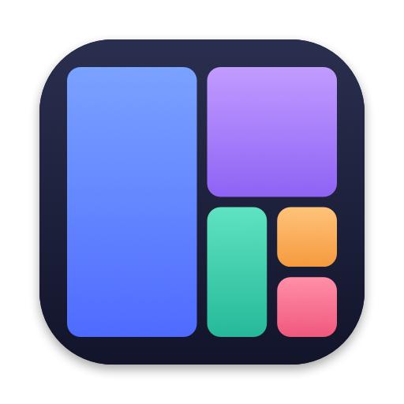

<p align="center">
  
</p>

<h1 align="center">Tilefy</h1>

<p align="center">
  An open-source auto-tiling window manager for macOS.<br>
  Dwindle, scrolling, master and more layouts, with Omarchy-style shortcuts.
</p>

<p align="center">
  <a href="https://github.com/sammathew4444/tilefy/actions/workflows/ci.yml"></a>
  <a href="LICENSE"></a>
  
</p>

| Dwindle | Scrolling |
| --- | --- |
|  |  |

*Screenshots from the automated tests, which run on real windows.*

Tilefy runs in the menu bar. Open a window and it finds its place, with nothing overlapping. It needs
no account or network, doesn't change any system settings, and doesn't require turning off System
Integrity Protection.

## Install

There's no prebuilt download yet, so build it from source. You need Xcode or its command line tools.

```sh
git clone https://github.com/sammathew4444/tilefy.git
cd tilefy
scripts/build-app.sh --install
```

This copies the app to `/Applications` and launches it. Turn on Tilefy under System Settings ›
Privacy & Security › Accessibility, and tiling starts straight away.

**This rearranges all your open windows.** To undo that, use the menu bar icon: Pause Tiling and Quit
both bring any windows parked out of sight back on-screen. To try it on one app first, run:

```sh
/Applications/Tilefy.app/Contents/MacOS/Tilefy --only-app=com.apple.TextEdit
```

## Layouts

Each workspace has its own layout.

| Layout | Behaviour | Shortcut |
| --- | --- | --- |
| Dwindle | Each new window splits the focused one, along its longer side | `⌃⌥D` |
| Scrolling | An endless row of columns that slides to follow focus | `⌃⌥S` |
| Master & Stack | One large window on the left, the rest stacked on the right | `⌃⌥M` |
| Centered Master | One large window in the middle, the rest on both sides | `⌃⌥X` |
| Grid | An even grid | `⌃⌥G` |
| Monocle | Every window fills the screen, and focus flips through them | `⌃⌥O` |

`⌃⌥L` toggles dwindle and scrolling, as `Super+L` does on Omarchy. `⌃⌥⇧L` steps through all six.

## Shortcuts

`⌃⌥` stands in for Omarchy's Super key. Choose a different modifier, or rebind any shortcut by
clicking it, in Settings.

| Keys | Action |
| --- | --- |
| `⌃⌥ ←↑↓→` | Focus in that direction, crossing displays at the edge |
| `⌃⌥⇧ ←↑↓→` | Swap in that direction, crossing displays at the edge |
| `⌃⌥N` / `⌃⌥⇧N` | Next / previous window on the workspace |
| `⌃⌥W` | Close window |
| `⌃⌥T` | Float / tile |
| `⌃⌥F` | Fullscreen within the workspace |
| `⌃⌥⌘F` | Full width |
| `⌃⌥=` / `⌃⌥-` | Grow / shrink width |
| `⌃⌥⇧=` / `⌃⌥⇧-` | Grow / shrink height |
| `⌃⌥0` | Reset sizes |
| `⌃⌥E` | Snap windows back into place |
| `⌃⌥A` / `⌃⌥⇧A` | Show or hide the scratchpad / move window to it |
| `⌃⌥1`…`9` | Go to workspace |
| `⌃⌥⇧1`…`9` | Move window to workspace, and follow it |
| `⌃⌥⌘1`…`9` | Send window to workspace, and stay |
| `⌃⌥⇥` / `⌃⌥⇧⇥` / `⌃⌥⌘⇥` | Next / previous / last workspace |
| `⌃⌥.` / `⌃⌥⇧.` / `⌃⌥⌘.` | Focus next display / move window to it / move workspace to it |

Layout-specific:

| Keys | Layout | Action |
| --- | --- | --- |
| `⌃⌥J` | Dwindle | Flip the split between side-by-side and stacked |
| `⌃⌥↩` | Master layouts | Promote window to master |
| `⌃⌥R` | Scrolling | Cycle column width: ½, ⅔, full |
| `⌃⌥C` | Scrolling | Center the column |
| `⌃⌥,` / `⌃⌥⇧,` | Scrolling | Stack into the left column / unstack |

With the mouse:

- Drag a window onto another to swap them, or onto another display to move it there.
- Drag a window's edge to resize the layout around it.
- Hold `⌃⌥` and scroll: up and down switch workspace, left and right move focus.

## Configuration

Most things are in Settings, which reads and writes `~/.config/tilefy/config.json`. You can also edit
that file, listing only what you want to change, then choose Reload Config File from the menu.

```json
{
  "defaultLayout": "scrolling",
  "innerGap": 12,
  "reserved": { "top": 30 },
  "floatApps": ["com.apple.calculator"],
  "appWorkspaces": { "com.apple.Mail": 4 },
  "bindings": { "mod+y": "layout-grid", "mod+w": "none" }
}
```

In `bindings`, `mod` is your shortcut modifier, `extra` is the one modifier it doesn't include, and
`none` removes a shortcut. The commands are listed in
[Command.swift](Sources/TilefyCore/Command.swift).

## Scripting

Like `hyprctl` on Hyprland:

```sh
tilefy=/Applications/Tilefy.app/Contents/MacOS/Tilefy
$tilefy dispatch workspace-2
$tilefy dispatch layout-grid
$tilefy status
```

## How it works

- **[`TilefyCore`](Sources/TilefyCore)** holds all the logic: layouts, workspaces, focus and the
  coordination of window events. It reaches macOS only through the
  [`WindowSystem`](Sources/TilefyCore/WindowSystem.swift) protocol.
- **[`Tilefy`](Sources/Tilefy)** is the app: Accessibility, hotkeys, the menu bar and Settings.
- **Workspaces are virtual**, as in AeroSpace. macOS has no public API for controlling Spaces, so
  windows on inactive workspaces are parked in a screen corner with one pixel showing, which makes
  switching instant.
- **Native Spaces still work.** Windows on other Spaces take no room in the current layout, and return
  to their slot when you come back.

## Testing

```sh
swift test                  # Logic, against a simulated Mac. Takes seconds and needs no permissions.
scripts/build-app.sh
scripts/e2e.sh --open       # Real windows. Needs Accessibility permission for Tilefy.
```

- **Unit tests** cover the layouts, config and shortcuts. Coordination tests run against a
  [simulated Mac](Tests/TilefyCoreTests/SimulatedMac.swift) with virtual time, for hard-to-reproduce
  cases such as late focus reports, Space switches and unplugged displays.
- **Stress tests** run long seeded random sequences of commands and events, checking after each step
  that no window has been lost and no layout is impossible.
- **Real-window tests** drive the actual app against actual windows, with synthesized keyboard and
  mouse input, and read positions back from the window server. They run on every push on GitHub's
  macOS runners. On your own Mac they quit any running Tilefy and manage only their own test windows.

CI runners have a single display, so multi-display behaviour and native Spaces are covered by the
simulated tests only. Reports from real setups are especially welcome.

## Limitations

- No window animations, or three- and four-finger trackpad swipes. Both would mean relying on
  janky or private APIs.
- Tilefy uses one private API, `_AXUIElementGetWindow`, as most Mac window managers do. That rules out
  the Mac App Store.
- Workspace assignments aren't remembered across restarts of Tilefy.

## Acknowledgements

Tilefy's ideas come from [Omarchy](https://omarchy.org) and [Hyprland](https://hyprland.org) (dwindle
and the shortcuts), [niri](https://github.com/YaLTeR/niri) and PaperWM (scrolling), and
[AeroSpace](https://github.com/nikitabobko/AeroSpace) (virtual workspaces). It isn't affiliated with
any of them.

## License

[MIT](LICENSE)
